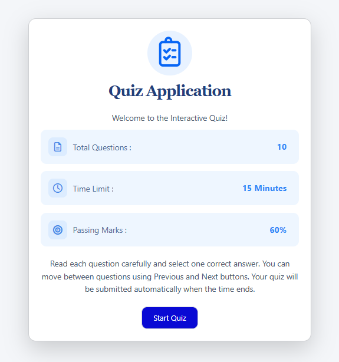
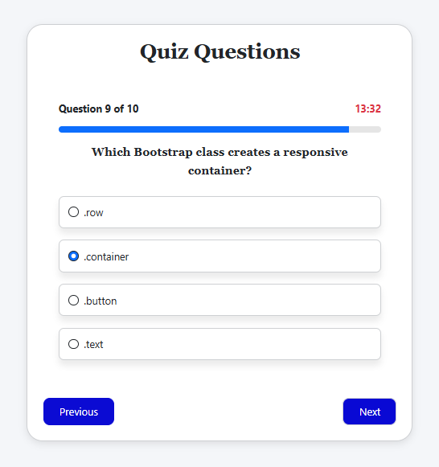
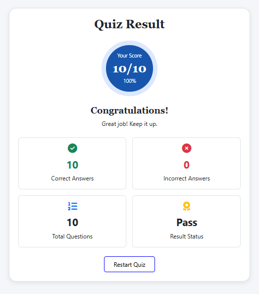

## Interactive Quiz App

An interactive and responsive Quiz App built using HTML, CSS, Bootstrap, and JavaScript. Users can answer multiple-choice questions, track their progress, and view their final quiz results.

## Screenshots

<table>
   <tr>
     <td align="center"><b>Welcome Page</b> </td>
     <td align="center"><b>Quiz Questions Page</b> </td>
   </tr>
   <tr>
     <td align="center"><b>Quiz Result Page</b> </td>
   </tr>
</table>

## Features

* Attractive and user-friendly welcome page.
* Displays total questions, time limit, and passing marks.
* Multiple-choice questions with answer selection.
* Countdown timer for the quiz.
* Progress bar to track quiz completion.
* Previous and Next buttons to navigate between questions.
* Submit option to finish the quiz.
* Displays final score and quiz result.
* Pass or fail status based on passing marks.
* Restart option to attempt the quiz again.
* Fully responsive design for desktop, tablet, and mobile screens.

## Technologies Used

* HTML5
* CSS3
* Bootstrap
* JavaScript

## Author

Laiba Fatima